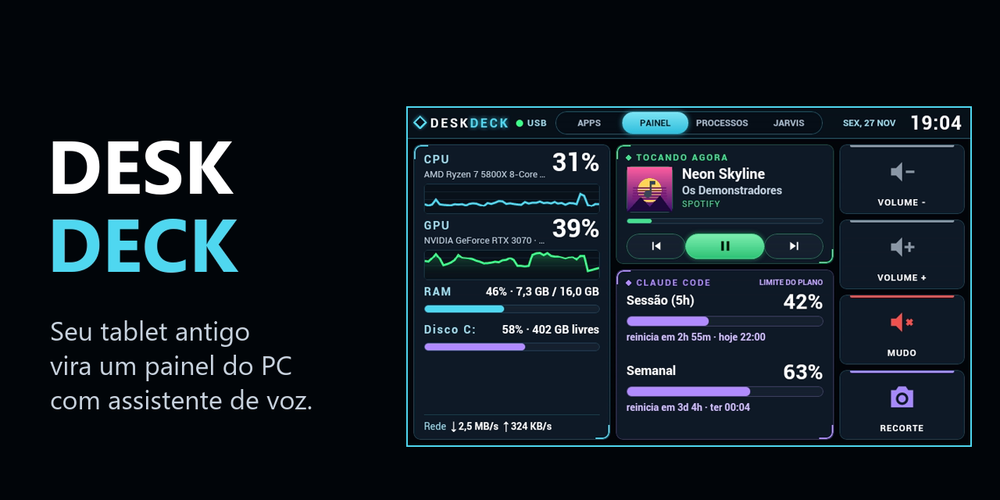
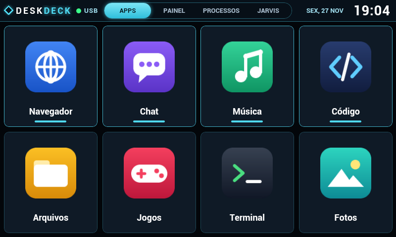
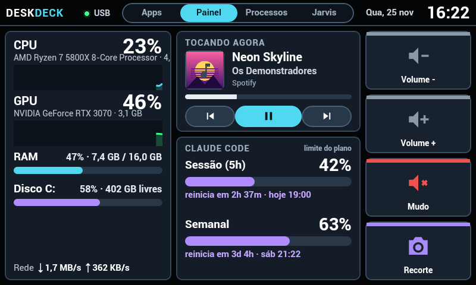
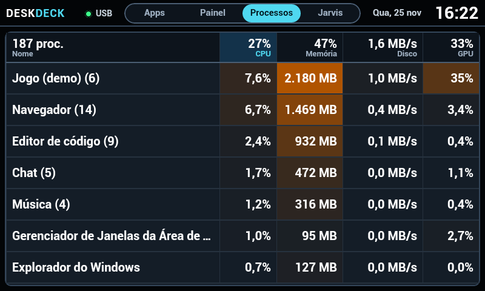
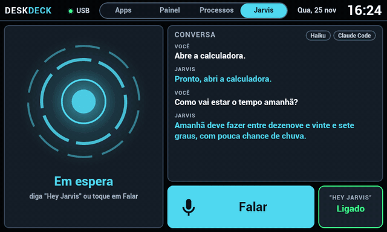

<p align="center"></p>

<p align="center">
  <b>Seu tablet antigo vira um painel de mesa para o PC, com assistente de voz.</b><br>
  Funciona até em tablets de 2012 (Android 4.1, 390 MB de RAM). Pelo cabo USB, sem nuvem, sem conta e sem root.
</p>

<p align="center">
  
  
  
  
</p>

---

## O que ele faz

| | |
|---|---|
|  | **Apps**: os apps fixados na sua barra de tarefas, com os ícones reais. Um toque abre no PC; um traço marca os que estão abertos. |
|  | **Painel**: CPU, GPU, RAM, disco e rede em tempo real · música tocando com controles · uso do **Claude Code** (sessão e semanal) · botões de volume, mudo e recorte. |
|  | **Processos**: os 7 programas que mais pesam, como no Gerenciador de Tarefas. Toque no cabeçalho para ordenar. |
|  | **Jarvis**: assistente de voz em português. Diga **"Hey Jarvis"** ou toque em Falar: ele abre apps, controla música e volume, tira print, diz o que está pesando no PC e responde perguntas usando o Claude Code. |

E também: tela cheia de verdade (cobre a barra do Android), inicia sozinho com o tablet e com o Windows, pede
**Permitir/Negar** no tablet antes de ações sensíveis, e pausa a escuta do Jarvis quando um jogo está em tela cheia.

## Leve de verdade

| | CPU | RAM |
|---|---|---|
| Painel ligado (abas Apps/Painel) | ~0,01% | ~70 MB |
| Com o "Hey Jarvis" escutando | ~0,35% | ~200 MB |
| Durante um jogo em tela cheia | escuta pausada, modelos de voz fora da memória | |

<sub>Medido num Ryzen 5 5600G. O agente só coleta o que a aba aberta no tablet mostra; com o tablet desconectado, não coleta nada.</sub>

## Instalação em 3 passos

**Você precisa de:** Windows 10/11, [Python 3.10+](https://www.python.org/downloads/), um tablet ou celular com
Android 4.1 ou mais novo, com a **Depuração USB** ligada, e um cabo USB de dados.

1. Baixe o projeto:
   ```powershell
   git clone https://github.com/Lazaro9850/Deskdeck.git
   cd Deskdeck
   ```
2. Instale no PC (o `-Jarvis` é opcional e baixa a voz e os modelos, ~1,1 GB):
   ```powershell
   powershell -ExecutionPolicy Bypass -File .\install_pc.ps1 -Jarvis
   ```
3. Conecte o tablet e aceite o pedido de depuração USB na tela dele. O app é instalado e aberto sozinho.

Para remover: `.\install_pc.ps1 -Uninstall` no PC e `adb uninstall br.local.painelpc` no tablet.

## Privacidade

* A voz é processada **no seu PC** (Whisper e Kokoro, locais). Só o **texto** do pedido vai para o Claude Code.
* O tablet fala com o PC só pelo cabo USB (`adb forward`); nenhuma porta fica aberta na rede.
* O login do Claude Code é usado apenas para consultar o uso do plano na própria Anthropic e nunca vai para o tablet nem para o log.

## Documentação

| | |
|---|---|
| [Jarvis](docs/jarvis.md) | o que dá para pedir, opções, consumo e arquivos |
| [Personalizar](docs/personalizar.md) | botões do Painel e integração com o Claude Code |
| [Tablet antigo](docs/tablet-antigo.md) | deixar o aparelho leve e compilar o app Android |
| [Arquitetura](docs/arquitetura.md) | como tudo se conecta, estrutura de pastas e modo demonstração |
| [Solução de problemas](docs/solucao-de-problemas.md) | sintomas comuns e limitações |

## Perguntas frequentes

**Precisa de root ou de desbloquear o tablet?** Não. Só a Depuração USB.

**Funciona pelo Wi-Fi?** Existe um modo Wi-Fi, mas sem criptografia (o Android 4.1 não tem TLS moderno). O USB é o recomendado.

**O Jarvis gasta minha assinatura do Claude?** Usa o limite do seu plano do Claude Code, como as barras da aba Painel
mostram. Pedidos simples vão para o Haiku e gastam muito pouco.

**Funciona no Mac ou no Linux?** Ainda não: o agente usa APIs do Windows para mídia, áudio, ícones e desempenho.

---

<sub>Inspirado no [PhoneBox](https://github.com/ersinkoc/phonebox), que exige Android 5+; este projeto foi escrito do zero para
aparelhos bem mais antigos. Os prints usam o [modo demonstração](docs/arquitetura.md#modo-demonstração), com dados fictícios.
Licença [MIT](LICENSE).</sub>
